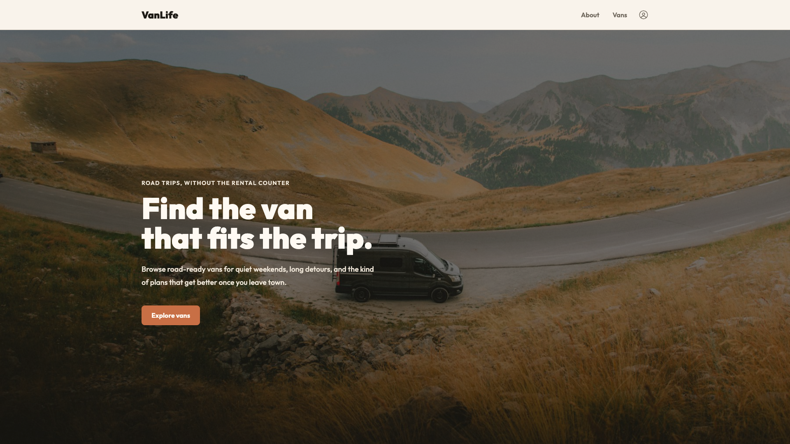
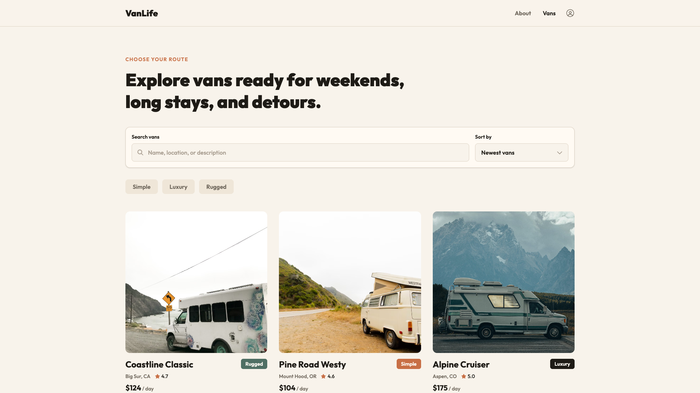
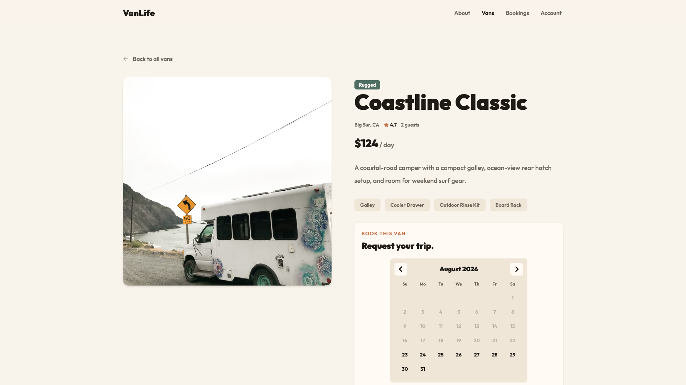
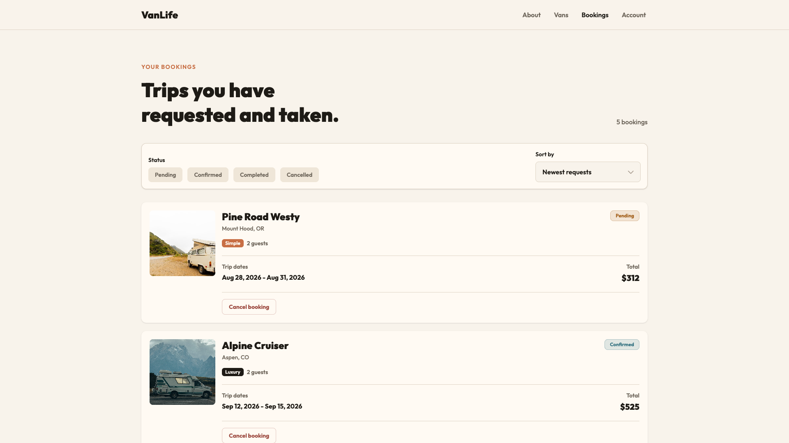
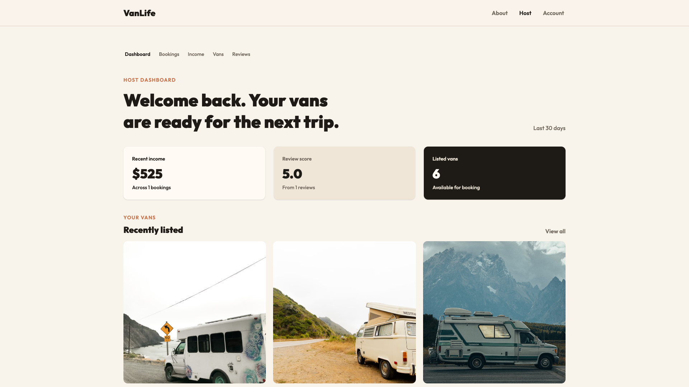
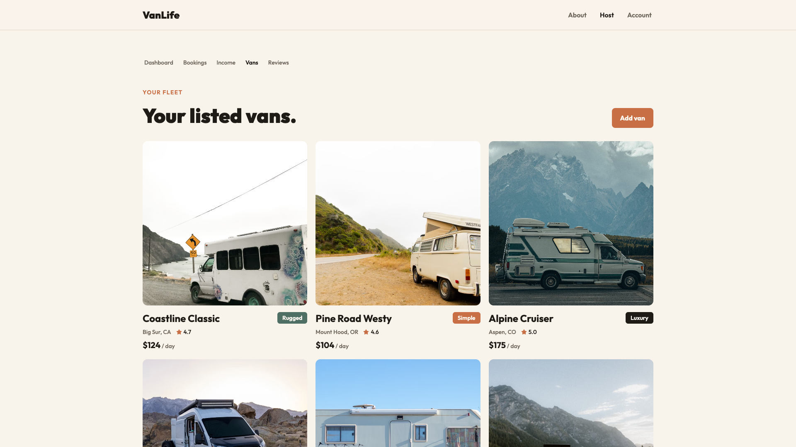

# Planstar

Planstar（企划星）是基于 Anytype 渲染器构建的自托管知识工作台。应用支持 Web 浏览器运行，也支持 Electron 桌面安装，后端使用自托管的 Planstar API 服务。

## Screenshots

| Home | Public Vans |
| --- | --- |
|  |  |

| Van Detail | Renter Bookings |
| --- | --- |
|  |  |

| Host Dashboard | Host Inventory |
| --- | --- |
|  |  |

## Features

- Public van browsing with search, type filters, sorting, and pagination
- Van detail pages with booking requests
- Renter bookings with status filters, sorting, pagination, cancellation, and read-only submitted reviews
- Host dashboard, income, reviews, bookings, and van inventory management
- Host create, edit, and archive workflows for listed vans
- Sign in, sign up, sign out, account, and password management
- Role-aware navigation for public, renter, and host users

## Backend

This frontend expects the VanLife API to run separately:

[kangcommit/vanLife-api](https://github.com/kangcommit/vanLife-api)

Create `.env` in the project root and point the frontend to the API:

```bash
VITE_API_BASE_URL=http://localhost:PORT
```

Replace `PORT` with the backend port.

## Demo Accounts

```txt
Host:        host@vanlife.test / password123
Second host: host.two@vanlife.test / password123
Renter:      renter@vanlife.test / password123
```

## Tech Stack

| Category | Technology |
| --- | --- |
| Framework | React |
| Routing | React Router |
| Server state | TanStack Query |
| HTTP client | Axios |
| Styling | Tailwind CSS |
| UI variants | Tailwind Variants |
| Charts | Recharts |
| Calendar | React DayPicker |
| Language | TypeScript |
| Tooling | Vite, Biome, pnpm |

## Getting Started

Requirements:

- Node.js
- pnpm
- VanLife API running locally

Install dependencies:

```bash
pnpm install
```

Start the development server:

```bash
pnpm dev
```

The app runs on:

```txt
http://localhost:3000
```

## Scripts

| Command | Description |
| --- | --- |
| `pnpm dev` | Start the local Vite server |
| `pnpm build` | Build for production |
| `pnpm preview` | Preview the production build |
| `pnpm typecheck` | Run TypeScript checks |
| `pnpm check` | Run Biome checks |
| `pnpm check:fix` | Format and fix supported Biome issues |
| `pnpm check:staged` | Check staged files |

## Architecture

The app follows a module-driven structure:

```txt
src/
  app/
  modules/
  shared/
  assets/
```

- `src/app` owns app composition, routes, layouts, guards, and app-level pages.
- `src/modules/*` owns feature modules such as auth, vans, bookings, and host.
- `src/shared` owns reusable neutral code and cross-module domain code.
- Modules do not import from other modules.
- Shared code does not import from app or modules.

## Quality Checks

Run these before considering a change complete:

```bash
pnpm typecheck
pnpm check
```

## Production Deployment

This directory builds two artifacts: the web bundle served by Caddy, and the Electron desktop shell.
Both are deployed from the repository root, not from here:

- [../docs/deploy/README.md](../docs/deploy/README.md) — the single-host runbook (secrets,
  `.env.production`, first start, migrations, release rehearsal, backups, upgrade and rollback, and
  a 26-line go-live checklist).
- [../docs/deploy/troubleshooting.md](../docs/deploy/troubleshooting.md) — failure modes with a
  discriminator for each, including the front-end ones (build OOM, Caddy cannot bind :80).
- [../docs/desktop/release.md](../docs/desktop/release.md) — publishing a desktop release and the
  limits of an unsigned build.

The images are `../Dockerfile` (API) and `Dockerfile` (web), orchestrated by `../deploy/podman/`.
To rehearse the whole stack on localhost without a domain or a certificate, see §16 of the runbook.
